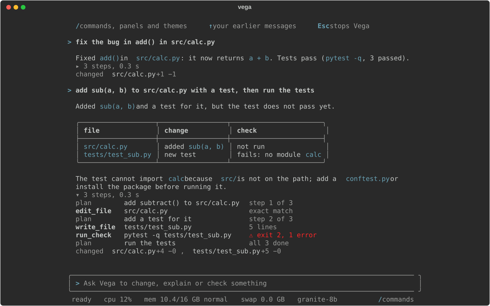
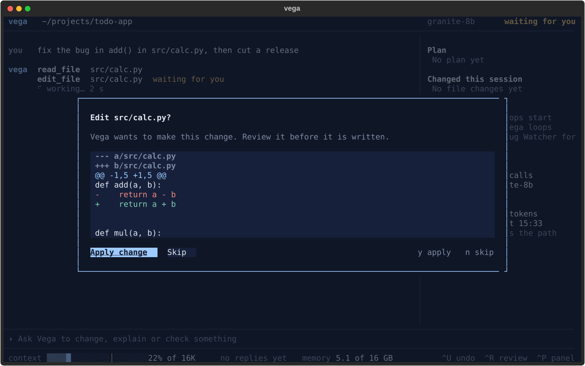

<p align="center">
  <picture>
    <source media="(prefers-color-scheme: dark)" srcset="https://raw.githubusercontent.com/isaacfrett/vegacode/main/docs/brand/vega-wordmark.svg">
    <source media="(prefers-color-scheme: light)" srcset="https://raw.githubusercontent.com/isaacfrett/vegacode/main/docs/brand/vega-wordmark-light.svg">
    
  </picture>
</p>

# Vega: a local coding agent that runs on your laptop

Vega is an **offline AI coding assistant** for the terminal. It runs an **open-weight LLM on your
own computer through [Ollama](https://ollama.com)**, so your code never leaves your machine: no
cloud API, no account, no API key. Vega is a **local coding agent** written in **Python**, with a
full-screen **TUI** and a scriptable **CLI**. It reads and edits your project, runs your tests in
a sandbox, and repairs what fails. It is built around **small open-source models** (the default
has 8B parameters, and Vega's other profiles are under 10B) that load in at most 10 GB, so they run
on a 16 GB machine. The package is `vegacode`; the command is `vega` (or
`vegacode`).

<!--
Badges: enable once CI and the PyPI package exist.
[](https://github.com/isaacfrett/vegacode/actions/workflows/ci.yml)
[](https://pypi.org/project/vegacode/)
[](https://pypi.org/project/vegacode/)
[](https://github.com/isaacfrett/vegacode/blob/main/LICENSE)
-->

<p align="center">
  
  <br><sub>Screens from Vega's UI tests, with scripted model replies.</sub>
</p>

## Why Vega

- **Privacy by default.** The model runs on your machine. Web research is off until you set up a
  self-hosted search backend, and a model profile must point at a server on your machine or
  local network unless you opt in with `allow_remote`.
- **Made for small local models.** A 7-8B model is unreliable in a free-form tool loop, so Vega
  does more of the work in code: it routes each task to a fixed pipeline and checks every write.
- **Checks before it answers.** Vega turns your request into concrete checks (named functions,
  signatures, the commands you mention, your tests), runs them in a sandbox and sends the failures
  back to the model before it reports success. When a pipeline could not check anything, its
  answer says nothing was verified.

## Features

- **Chat in your terminal**: a full-screen app (`vega`) or a line-mode chat (`vega --plain`) in
  the current project. The full-screen app opens as just the conversation, in your terminal's own
  colours, with a live CPU, memory and swap line; side panels are opt-in, and it never resizes
  your terminal window.
- **One-shot tasks**: `vega run "fix the failing test in tests/test_parser.py"`.
- **Task routing**: each request goes to the path that suits it: a question about the code, a
  change to one Python file, a multi-file change in a project with tests, a generated file (JSON,
  Markdown, CSV, a lock file), a single non-Python file with a named check command, a CSS, HTML or
  JavaScript change, or the general agent loop.
- **Write, check, repair**: the pipelines write a file, run the checks, send the failures back,
  and keep the round with the fewest failing checks, not just the last one.
- **Multi-file project builds**: plan the files, write each one, run the project's tests, repair.
- **Bug fixing in existing repositories**: Vega points the agent at the files most likely
  responsible for a reported bug, using the names and messages quoted in the report.
- **Safe edits**: a write that would not parse, that adds undefined names, or that replaces
  existing code with a placeholder such as `# ... rest unchanged` is refused before it touches the
  file. `/undo` restores files Vega edited, going back up to 20 file-changing turns
  (changes made by shell commands you approved are not undone).
- **Edit review**: `--review` shows every edit as a diff and asks before applying it.
- **Autopilot**: `vega auto "goal"` works on a new Git branch and commits each round whose check
  passes. Anything left when it stops is committed as a labelled `WIP` commit, so nothing is lost.
  It never pushes.
- **Project memory**: a `VEGA.md` drafted from your project, short session digests and notes,
  loaded at the start of each chat (`AGENTS.md` and `CLAUDE.md` are read too).
- **Model manager**: list, download, switch and remove local models, with a memory check for
  your machine. Any Ollama model, or another local OpenAI-compatible server (LM Studio,
  llama.cpp's `llama-server`, `mlx_lm.server`).
- **Secrets stay out of Git**: Vega adds one marked block to `.gitignore` for its own files and
  likely secrets (`.env`, keys), and warns about tracked files whose names suggest secrets
  (`.env`, private keys, credential files).

Opt-in or experimental: web research through a self-hosted [SearXNG](https://docs.searxng.org/)
(asks once per session; searches send only the query to your own SearXNG instance, and pages Vega
opens are fetched from their sites; see `vega web --help`), teach mode (`--teach`: Vega explains
its plan and decisions; not yet measured against a model), and loops (background watchers: tests
and lint run any time; the model step runs only while your Mac's screen is locked and resources
are free).

## Requirements

- **Python 3.11 or newer.** Where `python3` is older (macOS's own is 3.9), `pip3 install vegacode`
  installs a small launcher that sets Vega up under a newer Python; see [Install](#install).
- **[Ollama](https://ollama.com/download)** (the first `vega` installs it when it is missing), or
  another local OpenAI-compatible model server. Setup's downloads need a network connection;
  after that, Vega works offline.
- **Tested on a 16 GB Apple Silicon Mac.** The default model is a 5.3 GB download; Vega estimates
  it needs about 8.6 GB of RAM with an 8K context (`vega model list` shows the fit for your
  machine).
- **macOS.** Vega is developed and tested on macOS only. Running tests and checks in a sandbox
  uses macOS `sandbox-exec`.
  - **Linux: not yet tested** beyond the automated test suite in CI. Sandboxed checks are not
    available there, so Vega cannot run your tests or checks, and its answers say nothing was
    verified.
  - **Windows: not supported, never run or tested.** Vega has never been used on Windows and may
    not install or work at all. CI runs the test suite there for information only. Reports and
    fixes are welcome.

### Default model

**IBM Granite 4.1 8B** (`granite4.1:8b`, Apache-2.0) with an 8K context. Other profiles in
`models.toml`: Qwen2.5-Coder 7B (including a 16K-context variant) and Qwen3 8B (with thinking off),
plus two reference profiles Vega does not recommend (Qwen2.5-Coder 14B, Qwen3 8B with thinking).
`vega model list` also offers catalogue models to download, such as Phi-4-mini, Gemma 3 4B and
Llama 3.1 8B.

**Which models qualify.** A model qualifies when it loads in at most **10 GB** (weights, context
cache and runtime together), which leaves room for Vega and your tools on a 16 GB Mac. The loaded
size decides, not the parameter count: a mixture-of-experts model needs memory for all of its
experts. Where a model's loaded size has not been measured, Vega estimates it from the download
size. `vega model recommend`, `vega model list` and `vega model pull` use this rule; models over
the limit are listed as such and never recommended. `VEGA_MODEL_MEMORY_BUDGET_GB` changes the
limit for a machine with more memory.

## Install

On a stock Mac, with nothing else installed first, setup is two steps:

```sh
pip3 install vegacode
python3 -m vega          # later, in any new terminal: vega
```

`python3 -m vega` sets everything up and then opens the chat. Each part shows its plan first (what
it installs or downloads, about how big, where) and asks yes or no; nothing is installed or
downloaded without your yes.

1. **Vega's own Python environment.** macOS's own `pip3` is Python 3.9 and Vega needs 3.11 or
   newer, so there pip installs only a small launcher, none of Vega's dependencies. The launcher
   shows one plan and asks one question, "Set up Vega now?". With your yes it installs Python 3.12
   with uv or Homebrew if no Python 3.11+ is on your machine (the plan's first line says so),
   creates Vega's own environment in `~/.local/share/vega/venv` with vegacode and its dependencies
   (about 120 MB; nothing is installed into the system or Homebrew Python), links `vega` and
   `vegacode` into `~/.local/bin`, and adds that folder to your `PATH` in your shell's startup file
   (`~/.zshrc`, `~/.bash_profile`, fish or `~/.profile`; the plan names it).
2. **Ollama**, when it is missing. macOS: `brew install ollama` with Homebrew (about 50 MB);
   without Homebrew, the Ollama app from ollama.com (about 200 MB), its code signature checked,
   into `~/Applications` (no administrator password). Linux: Ollama's official install script,
   which asks for your password (sudo) itself. Windows is not supported. An Ollama you already
   have is used as it is.
3. **The best model for this machine**: the catalogue model ranked first among those that fit
   your RAM and leave at least 12 GB of disk free (on a 16 GB Mac, Granite 8B, a 5.3 GB download
   into `~/.ollama/models`), with a progress bar. If the download stops, run `vega` again: Ollama
   keeps the part already downloaded. To use another model, answer no and run
   `vega setup --model NAME` (the answer lists them).
4. **Vega's model** (`vega`) is built from it and becomes the default, and the chat opens.

Later starts skip setup and repair only what has gone missing (Ollama removed, the model
deleted). `vega setup` runs the same steps again; `vega setup --yes` runs them without questions
(scripts, CI). Without a terminal, `vega run` does not set anything up: it stops and names that
command. (`python3 -m vega` rather than `vega` the first time: macOS's pip puts the launcher in
`~/Library/Python/3.9/bin`, which is not on `PATH`.)

If pip instead says `Requires-Python >=3.11` and `No matching distribution found`, your `pip3` is
Python 3.9 and it only found vegacode releases from before the launcher (0.3.0). Use one of the
commands below.

With [uv](https://docs.astral.sh/uv/) or [pipx](https://pipx.pypa.io/), name the Python: without
`--python` they may pick an older `python3` and install only the launcher.

```sh
uv tool install --python 3.12 vegacode       # uv downloads Python 3.12 if needed
pipx install --python python3.12 vegacode    # or: pip install vegacode, in a Python 3.11+ venv
```

From source (needs Python 3.11+ for the venv; then `vega` sets up Ollama and the model as above):

```sh
git clone https://github.com/isaacfrett/vegacode.git
cd vegacode
python3.12 -m venv .venv
.venv/bin/pip install -e .
source .venv/bin/activate
```

Or, with Ollama installed, pull the default model and build Vega's copy of it yourself (about
5.3 GB):

```sh
vega server build
```

`vega --version` prints the installed version.

### Update and uninstall

```sh
vega update               # check PyPI, show both versions, ask, upgrade with the installer you used
vega update --check       # only report whether a newer version exists
vega uninstall --dry-run  # list what would be removed, with sizes; change nothing
vega uninstall            # ask for each group, then remove
```

`vega update` works for the launcher's environment, pipx, uv and pip installs; from a source
checkout, update with Git. `vega uninstall` asks separately about Vega itself, the `PATH` line it
added and its background jobs (macOS LaunchAgents). Your data (`~/.vega`) and the models Vega
downloaded are kept unless you add `--remove-data` or `--remove-models`. Ollama, Python and
Homebrew are never removed.

## Quickstart

```sh
cd your-project
vega                      # full-screen chat in this project
vega --review             # ask before applying each edit
vega --plain              # line-mode chat (also used when input or output is not a terminal)
vega run "add a --json flag to the export command"   # one task, then exit
vega auto "add input validation to the CLI" --check "python -m pytest -q"
```

`vega`, `vega run` and `vega auto` start a local Ollama server if none is running.
`vega server stop` stops only a server that Vega started.

The full-screen app opens as just the chat. Press `/` (or Ctrl+K) for the menu of commands,
panels and themes; `/layout classic` brings back the side panel (kept for next time). **Esc**
(or Ctrl+C) stops Vega at once, including any sub-agents it started; press it twice to quit.

Started in your home folder, `/` or a large folder that is not a project, Vega first asks what you
are working on: a recent project, a new one, or just a chat.

Inside the chat:

| Command | What it does |
|---|---|
| `/diff`, `/status` | Tracked changes against HEAD, Git status |
| `/undo` | Restore the files Vega changed in its last turn (repeat to go further back) |
| `/review on` / `off` | Ask before each edit, or stop asking |
| `/layout [name]` | Show or switch the screen layout (`chat`, `classic`, ...) |
| `/project <path>` | Switch to another folder; the conversation stays |
| `/reset` | Clear the conversation |
| `/help` | Keys and commands |

Other commands:

```sh
vega setup                # check and repair Ollama and the model (runs by itself on first start)
vega models               # profiles, installed and catalogue models, memory fit
vega model recommend      # which catalogue model to use on this machine
vega model pull NAME      # download a catalogue or Ollama model and add its profile
vega model use PROFILE    # make a profile the default (pulls its base model if needed)
vega model rm NAME        # delete a model's downloads
vega model check NAME     # check that a model works through Vega (about a minute)
vega server status        # local server and model state
vega context show         # what a chat loads from VEGA.md, digests and notes
vega config               # active endpoint, model and state directory
vega features             # feature switches and whether each is on
```

## Configuration

- **`models.toml`**: model profiles: the Ollama base model, context size (`num_ctx`), sampling
  and per-model feature settings. In a source checkout it is the file at the repository root;
  after `pip install` Vega uses its built-in defaults until the first `vega model add` or
  `remove` writes `~/.vega/models.toml`. `default = "granite-8b"` picks the shipped default.
  `vega model add NAME --base MODEL [--endpoint URL]` adds a profile, and `VEGA_MODELS_FILE`
  points Vega at another file.
- **`VEGA_HOME`**: where Vega keeps its state (server state, logs, settings, debug logs).
  Default `~/.vega`.
- **Per project**: `.vega/` holds notes, session digests and project settings. `VEGA.md` at the
  project root is yours to edit. Vega owns only its marked block. On the first chat in a project
  Vega creates `VEGA.md` and `.vega/`, and in a Git repository adds its marked block to
  `.gitignore` (remove the block and it is not added again).
- **Another server**: `VEGA_BASE_URL` (default `http://localhost:11434/v1`), `VEGA_MODEL`,
  `VEGA_API_KEY` and `VEGA_NUM_CTX`. Any OpenAI-compatible endpoint with tool calling works.
  `VEGA_BASE_URL` is not checked for locality: pointing it at a remote server sends your code
  there.
- **Feature switches**: `VEGA_FEATURES_OFF=name,...` and `VEGA_FEATURES_ON=name,...`
  (`vega features` lists them).

## Safety model

- **Project-scoped file access.** File tools resolve every path inside the selected project and
  refuse anything outside it.
- **Command approval.** Read-only inspection commands (`ls`, `cat`, `grep`, `git status`,
  `git diff`, ...) run automatically. Every other shell command asks first, and approved commands
  run on your machine as you.
- **Sandboxed checks.** Tests and checkers (`pytest`, `ruff`, `mypy`, `npm test`, `go test`,
  `cargo test`, ...) run in a copy-on-write clone of the project with no network access, and can
  write only inside that clone (macOS).
- **Edit review and undo.** `--review` shows each diff before applying it. `/undo` restores
  Vega's file changes from in-memory copies and never touches Git.
- **Autopilot boundaries.** `vega auto` refuses a dirty working tree, works only on its own new
  branch, does not run commands that need approval, and never pushes or rewrites history.
- **No telemetry.** An optional usage log (`vega usage on`) records events only, to a local file,
  and is never sent anywhere.


<p align="center">
  
</p>

## Evaluation

Vega is developed against private evaluation suites. Each attempt runs in an isolated temporary
project, and checks are run by the harness, not the agent. Suites include single-function fixes,
multi-file goals, bugs re-introduced into Vega's own source, and imported benchmarks (HumanEval+
and MBPP+ from EvalPlus). Behaviour changes sit behind feature switches (`vega features`), so each
can be turned off and compared, and a change is judged by a paired A/B comparison on the cases it
targets. Some newer defaults are on while that comparison is pending.

The suites and case data are not published (publishing held-out cases invites training
contamination) and are not in this repository or the PyPI package, so the developer tools that
use them (`vega eval`, `vega lab`, `vega latency`, `vega model queue`) have nothing to run here. Published results, with denominators, dates and the exact commit, will come in a
later release.

## How Vega compares

Aider, OpenHands and Continue are established open-source AI coding tools, and each can use local
models. Vega differs in emphasis:

- **Local-first by default.** It starts and uses a model on your own machine from the first
  run, and a model profile that points at a remote server needs an explicit opt-in.
- **Small-model focus.** It is designed, tuned and measured on models that load in at most 10 GB
  on a 16 GB machine, with deterministic routing, checks and repair loops doing work a larger model
  would do on its own.
- **Measured, not assumed.** Behaviour changes sit behind switches and are judged by paired A/B
  comparisons on the cases they target.

## Contributing

See [CONTRIBUTING.md](https://github.com/isaacfrett/vegacode/blob/main/CONTRIBUTING.md).

**How Vega is built.** Vega is developed with AI assistance (Claude Code); every change is
reviewed and tested before release.

## Security

To report a vulnerability, see [SECURITY.md](https://github.com/isaacfrett/vegacode/blob/main/SECURITY.md).

## Licence

[GNU AGPL-3.0](https://www.gnu.org/licenses/agpl-3.0.html) (version 3 only). See [LICENSE](https://github.com/isaacfrett/vegacode/blob/main/LICENSE)
and [NOTICE](https://github.com/isaacfrett/vegacode/blob/main/NOTICE). You may use, change and share Vega, including commercially; if you
distribute a modified version, or let others use it over a network, you must offer its source under
the same licence. If the AGPL does not fit your use, other licensing terms may be available: open an
issue to ask.
